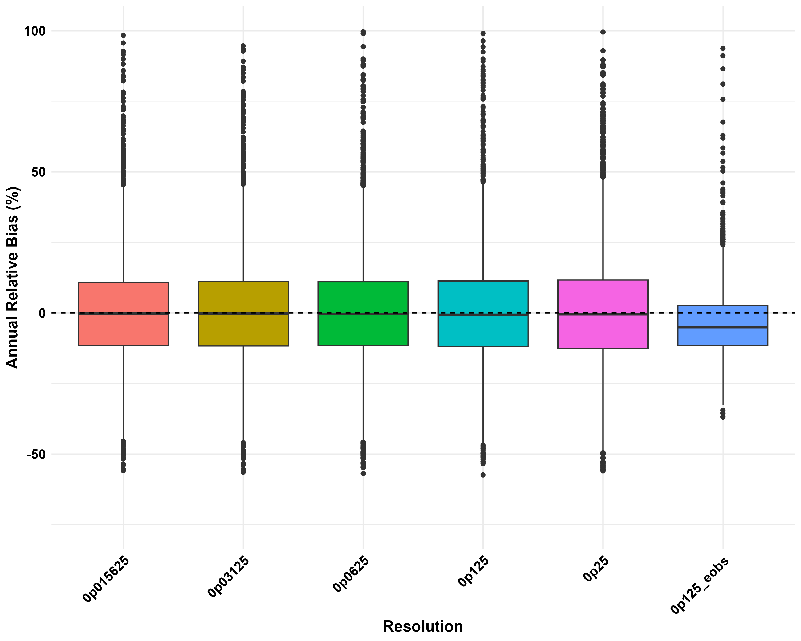
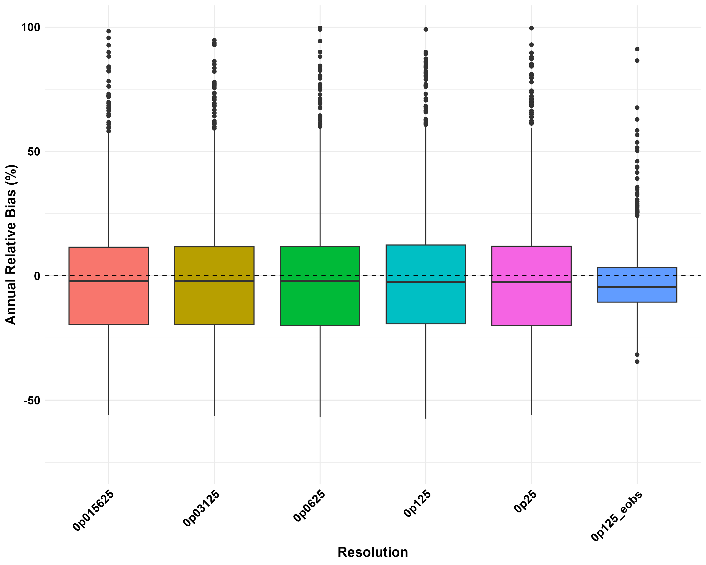
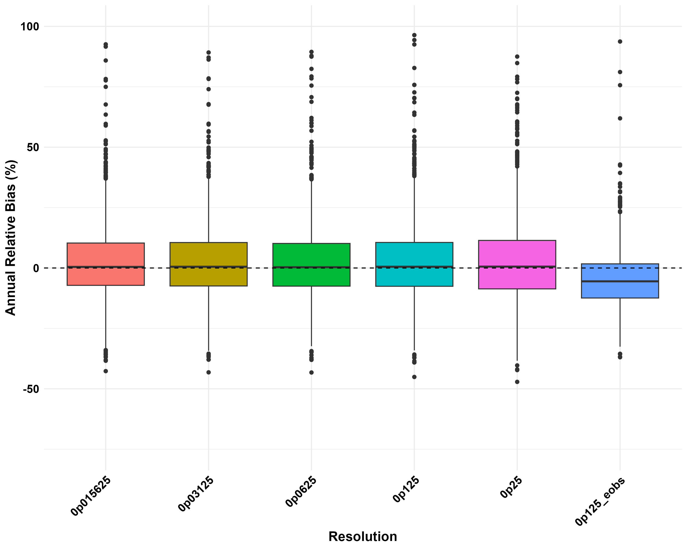
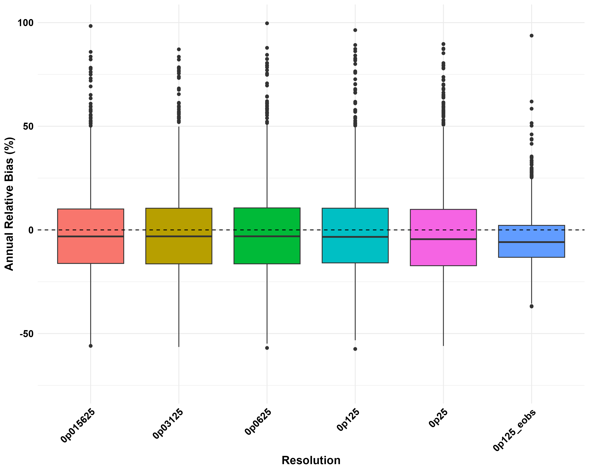
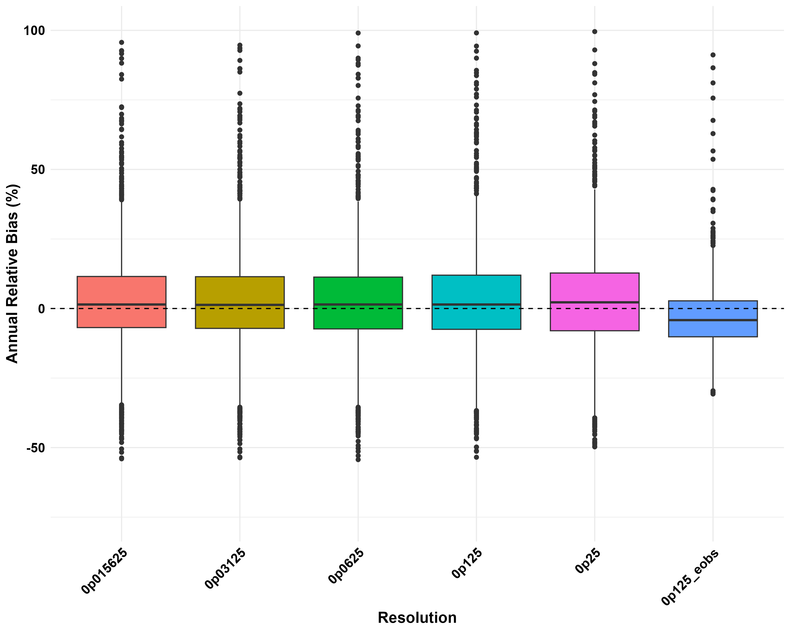
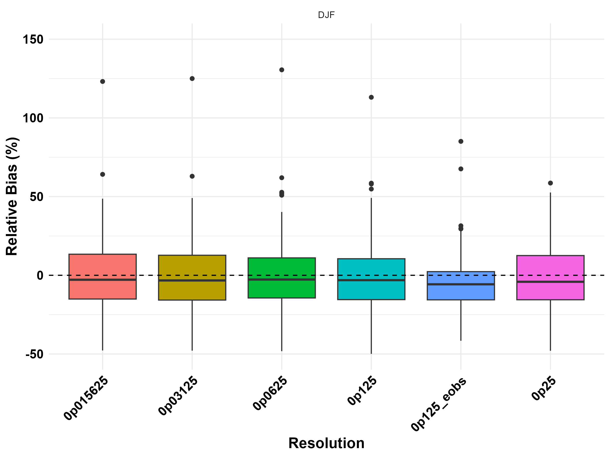
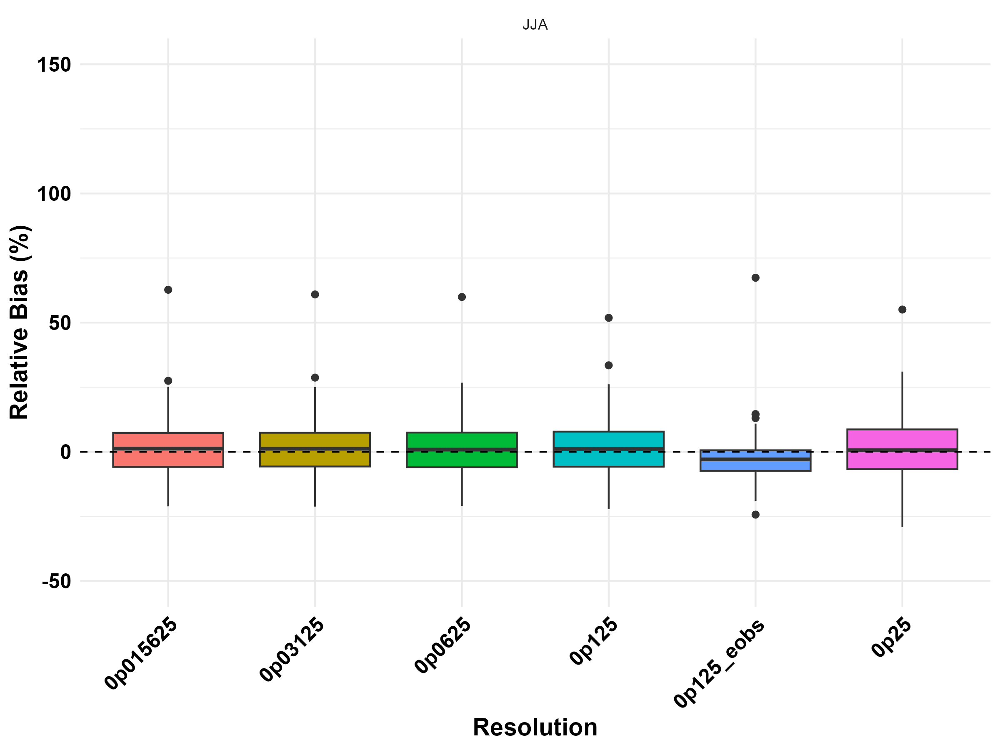
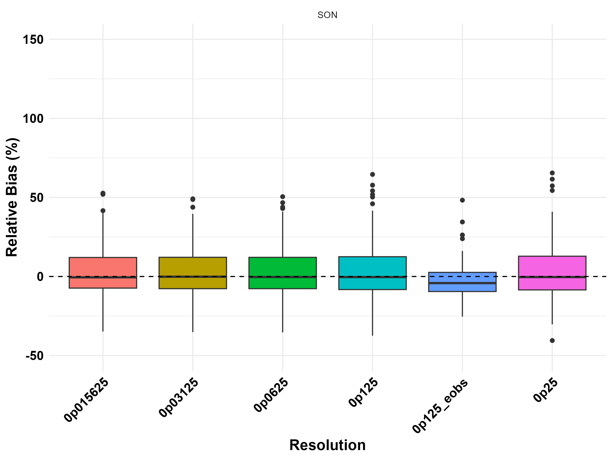

# Evaluation of Precipitation Uncertainty in Gridded Datasets

### Bachelor's Thesis | Czech University of Life Sciences Prague | 2025

## Project Overview

This project is based on my bachelor's thesis in Environmental Data Science at the Czech University of Life Sciences Prague.

The aim was to evaluate how accurately gridded precipitation datasets represent rainfall observations in Czechia and whether higher spatial resolution leads to better results.

I compared two European precipitation datasets, **EMO-1 and E-OBS**, with observations from **146 rain gauge stations** across Czechia over the period **1990–2009**.

The analysis also examined how precipitation estimation errors change depending on elevation, season, and time period.

## Tools and Technologies

- **R** — data processing, statistical analysis, and visualisation
- **dplyr, tidyverse, tibble** — data manipulation and aggregation
- **ggplot2** — data visualisation
- **ncdf4** — processing NetCDF files
- **lubridate** — working with dates and timestamps
- **Climate Data Operators (CDO)** — preprocessing gridded precipitation datasets
- **Ubuntu / Bash** — processing meteorological data files

## Methodology

The analysis included the following steps:

1. Processing rain gauge observations and extracting station information, including coordinates and elevation.
2. Reading and preparing precipitation data from NetCDF files.
3. Converting timestamps and matching gridded observations with rain gauge measurements.
4. Calculating annual precipitation totals and relative bias.
5. Comparing the performance of different spatial resolutions.
6. Analysing differences between two time periods, four seasons, and two elevation groups.
7. Creating boxplots to compare the results.

Relative bias was used to measure the percentage difference between gridded precipitation estimates and observed precipitation.

## Results and Visualisations

### 1. Overall Relative Bias

*Annual relative bias across different spatial resolutions of EMO-1 and E-OBS during 1990–2009.*

The median bias was close to zero for most EMO-1 resolutions, while E-OBS showed a tendency to underestimate precipitation. The results did not show a clear improvement in accuracy when using higher spatial resolutions.

### 2. Comparison Between Time Periods

**1990–1999**

**2000–2009**

*Comparison of annual relative bias during two consecutive decades.*

The analysis showed greater variability in relative bias during 1990–1999. During 2000–2009, the distribution became narrower, suggesting more consistent precipitation estimates.

### 3. Influence of Elevation

To examine the effect of elevation, the rain gauge stations were divided into two groups based on the median elevation of approximately 435 m.

**Stations above the median elevation**

**Stations below the median elevation**

*Comparison of relative bias between higher- and lower-elevation stations.*

The results showed larger variability in precipitation bias at higher elevations. This suggests that mountainous terrain creates additional difficulties for accurately estimating precipitation.

### 4. Seasonal Variability

The data were also analysed separately for the four meteorological seasons.

**Winter (DJF)**

Winter showed predominantly negative biases, suggesting that precipitation was generally underestimated. This may be related to difficulties in measuring snowfall.

**Spring (MAM)**

Spring showed relatively stable precipitation estimates, with smaller biases compared with winter.

**Summer (JJA)**

Summer showed both positive and negative biases. Localised convective rainfall events may contribute to differences between gridded estimates and rain gauge observations.

**Autumn (SON)**

Autumn generally showed smaller biases and more stable precipitation estimates compared with winter.

## Key Findings

The analysis led to several main conclusions:

- Higher spatial resolution did not necessarily improve the accuracy of gridded precipitation estimates.
- Precipitation bias was generally more pronounced at higher elevations.
- Winter showed considerable underestimation, while spring and autumn had relatively smaller biases.
- The variability of precipitation estimates decreased during 2000–2009 compared with 1990–1999.
- Both EMO-1 and E-OBS showed limitations under certain climatic and geographical conditions.

## Limitations

The study was based on 146 rain gauge stations and two gridded precipitation datasets. Relative bias was the main evaluation metric, so other statistical measures could provide additional insight into dataset performance.

The original datasets are not included in this repository. They can be obtained from their respective data providers.

The R script represents the original research workflow and requires the corresponding external datasets, software dependencies, and file-path configuration to be executed.

## Repository Contents

- `thesis_analysis.R` — R code used for data processing, analysis, and visualisation.
- `figures/` — selected graphs from the thesis.

